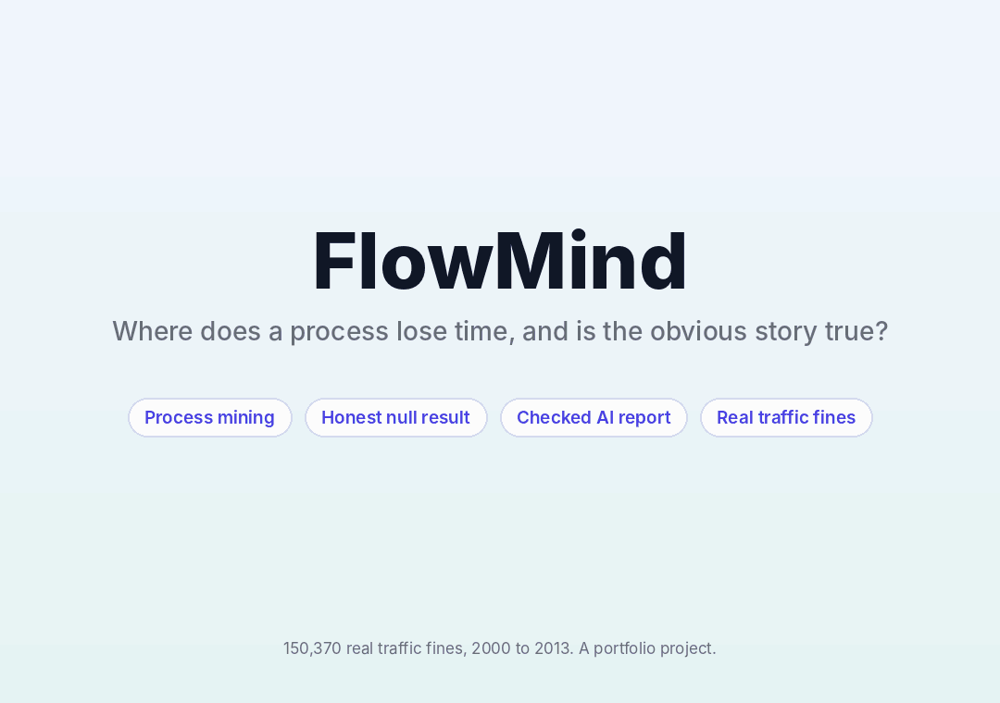
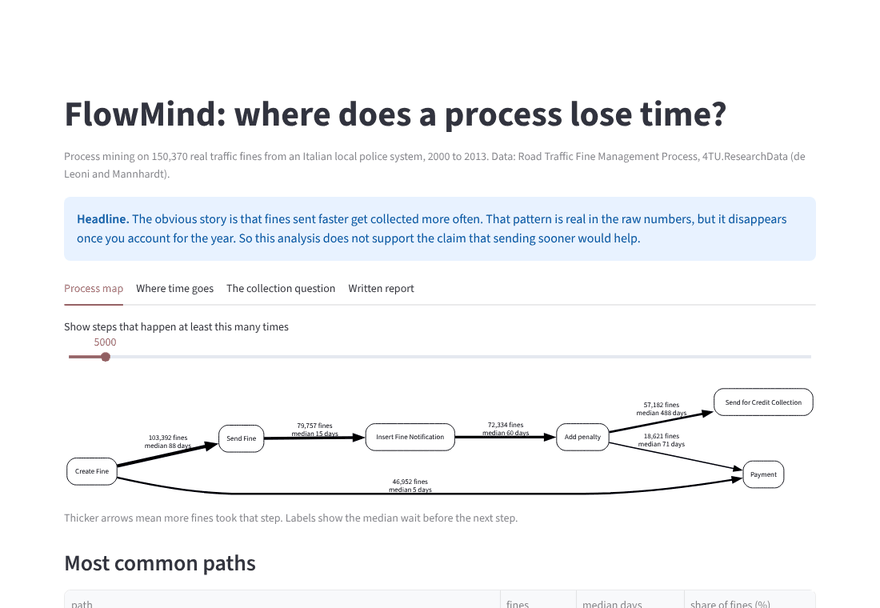
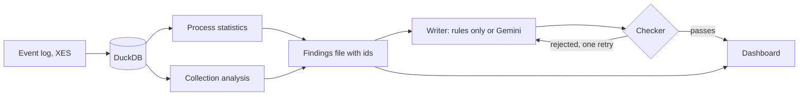

# FlowMind

A process mining project on 150,370 real traffic fines. It maps where the process spends its time, tests whether a popular explanation holds up, and has an AI write the findings up under strict checks.

**Status: in progress.** Everything below runs and is tested, except the Gemini writer, which I am still evaluating. The page and the checks work today with a writer that needs no AI.

## The result, up front

The obvious story is that fines sent out faster get collected more often. In the raw numbers that looks true: fines sent within 30 days ended in credit collection 68.7% of the time, and fines sent after 120 days did so 50.3% of the time.

It does not survive a fair comparison. The wait before sending grew from a median of about 49 days in 2000 to about 125 days by 2004, and the collection rate fell over the same years. Once I compare fines from the same year, one extra month of delay multiplies the odds of collection by 0.992 (95 percent interval 0.977 to 1.008). That is not clearly different from no effect.

| How year is handled | Odds ratio per extra 30 days |
|---|---|
| Ignored | 0.833 |
| Treated as a number | 0.901 |
| Each year compared separately | 0.992 |

Two more checks agree. A model trained on fines from before 2006 ranks later fines at an AUC of 0.509, which is chance. And a modelled "send everything 30 days sooner" scenario moves the collection rate by about +0.2 percentage points (90 percent interval -0.1 to +0.5), and that already assumes the link is causal.

So the honest answer is that this data does not support the claim that sending sooner would improve collection. I think a result like that is worth more than a clean story, so I kept it as the headline.

**[Live dashboard](https://flowmind-process-mining-krxaeyrh5vehqtfapzgdyr.streamlit.app/)**





## What else it found

* The longest wait is from adding a penalty to sending for credit collection (median 488 days, 58.7% of all elapsed time). That is partly a legal timeline, not a delay.
* Every wait between the notification and the penalty is within an hour of exactly 60 days. That is a built in rule, so it is not a bottleneck to remove.
* Only 37.6% of fines follow the full path to credit collection. 30.8% are paid right away.

## How it works



1. **Load.** The event log is read with pm4py and stored in DuckDB. Every event gets a stable id.
2. **Plain statistics decide the facts.** Paths, waits between steps, rework, and the collection analysis are ordinary pandas and statsmodels code. No AI touches a number.
3. **Findings file.** Each result becomes a finding with an id and sentences with the numbers already formatted.
4. **The writer only writes.** It may use only the findings file, and every statement must cite finding ids.
5. **A checker reviews every statement.** A report is rejected if it cites an id that does not exist, uses a number that is not in the findings it cites, uses causal wording such as "causes" or "leads to", or skips a required finding, including the caveats. The writer gets one retry with the problems listed.

## The collection analysis, and what I did to avoid fooling myself

* **Unfinished cases are removed.** Fines created after October 2009 had not had time to be collected, so counting them as "not collected" would be wrong. The cutoff comes from the data: 99 percent of collections happen within 1,334 days.
* **Only information known at sending time is used.** Dismissal, expenses and notification type are left out on purpose because they are decided later. A test checks that they stay out.
* **Years with very few cases are dropped.** One year had a single collected fine, which makes a model impossible to fit. The code now raises an error on a model that did not converge instead of reporting it.
* **Uncertainty is reported.** Intervals come from the model and, for the scenario, from resampling the model coefficients.
* **The planted effect test.** The tests simulate data with a known effect and check that the method recovers it. I checked coverage over 30 random seeds first (97 percent for a 95 percent interval).

## Does the checker work?

I damage a valid report in six known ways and count how many damaged reports the checker catches. All 51 were caught.

| Damage | Caught |
|---|---|
| A number changed | 8 of 8 |
| A finding id that does not exist | 9 of 9 |
| Causal wording added | 9 of 9 |
| Citing the wrong finding | 9 of 9 |
| A required finding dropped | 7 of 7 |
| An invented extra claim | 9 of 9 |

I also test that an instruction hidden inside a finding does not get the writer to make a causal claim. This tests the checker, not Gemini. The Gemini writer has had no full evaluation yet. When it is done, the results will go in `eval/`.

```
python src/evaluate.py data/findings.json eval/results_checker.json
```

## Limitations

* **This is an association study.** Nothing here shows that sending sooner would or would not change collection. Process changes over the years, such as staffing or law changes, are not in the data. Comparing within a year controls for them only partly.
* **"Collected" means the fine was sent for credit collection.** The data does not say how much money came back.
* **One dataset, one domain.** It is a single Italian local police system.
* **The checker checks numbers and wording, not meaning.** It can prove a sentence points at a real finding. It cannot prove the sentence is a wise reading of it.
* **The 60 day rule and the legal timelines** are inferred from the pattern in the data. Confirm them with the process owner before acting.

## Run it on Windows

You need Python 3.10 or newer.

```
python -m venv .venv
.venv\Scripts\activate
pip install -r requirements-dev.txt
python -m pytest -q tests
python -m streamlit run app.py
```

The app needs only `data/summary.json`, which is included. To rebuild it from the real log:

1. Download the Road Traffic Fine Management Process log from 4TU.ResearchData (search for the title) and save it in `data/raw/`.
2. Run:

```
python src/load_log.py data/raw/Road_Traffic_Fine_Management_Process.xes.gz data/rtf.duckdb
python src/findings.py data/rtf.duckdb data/findings.json
python src/make_summary.py data/rtf.duckdb data/summary.json
```

To try the Gemini writer, set a key in the same window and run:

```
$env:GEMINI_API_KEY = "your-key"
python src/investigator.py data/findings.json --gemini
```

Never commit a key.

## Repository layout

```
app.py                     dashboard (Streamlit)
src/load_log.py            event log to DuckDB
src/process_stats.py       paths, waits, rework
src/analysis.py            comparisons, bottlenecks, what if simulation
src/collection.py          collection model, sensitivity, scenario
src/findings.py            results to a findings file with ids
src/investigator.py        writers, report schema, checker
src/make_summary.py        builds the small file the dashboard reads
src/evaluate.py            damages reports to test the checker
tests/                     31 tests
data/summary.json          what the dashboard reads
data/findings.json         the cited findings
eval/                      saved evaluation results
```

## Data and credit

The Road Traffic Fine Management Process event log is from 4TU.ResearchData, by M. de Leoni and F. Mannhardt. The raw log is not in this repository. Please get it from the source and cite the authors if you use it.
